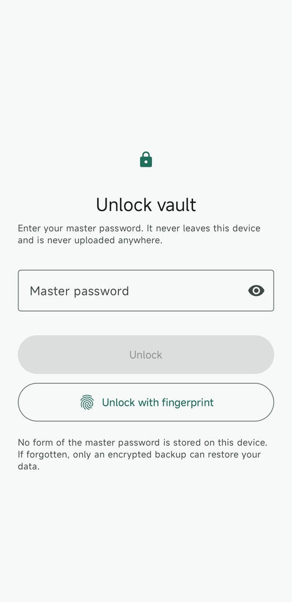
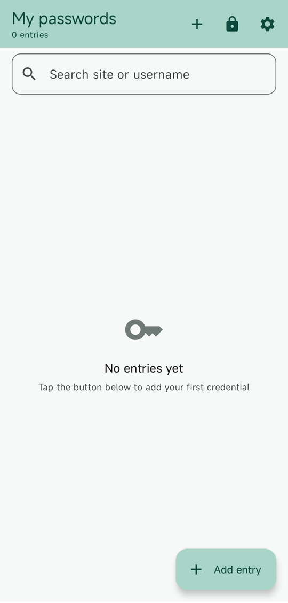
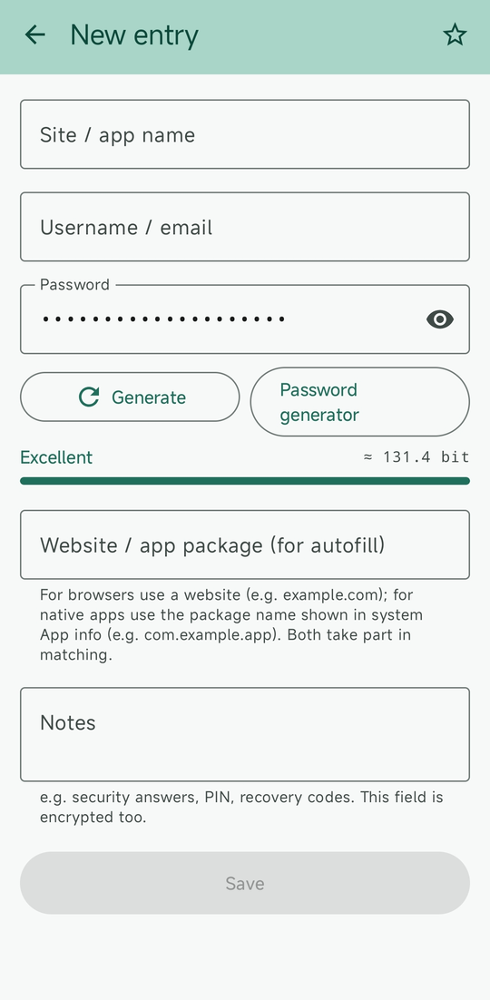
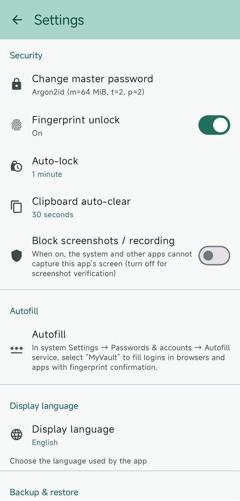

# MyVault

An offline-first, **zero-network-permission**, self-verifying local password manager for Android.

Generates strong passwords (random, memorable passphrase, or PIN), stores credentials encrypted with
Argon2id + AES-256-GCM, fills them into other apps and browsers through the system autofill
framework, supports fingerprint unlock, exports/imports encrypted backups that you keep yourself, and
hands a single credential to another device as a QR code.
The UI ships in English and Simplified Chinese.

<!-- Screenshots: docs/screenshots/01-setup.png is still the Chinese UI, so it is not
     published yet. Re-capture it in English and add it here once available. -->

## Screenshots

<p align="center">
  
  
  
  
</p>

<p align="center"><sub>Unlock &middot; vault list &middot; entry editor &middot; settings</sub></p>

## Features

- **Password generator** — random characters, memorable passphrase, or digits-only PIN. Configurable
  length, character classes, and look-alike exclusion; optional guarantee that every selected
  character class appears at least once; passphrase separator and capitalisation. Shows the resulting
  entropy and an estimated offline-cracking time.
- **Encrypted vault** — field-level AES-256-GCM, keyed through Argon2id, so ciphertext cannot be moved
  between entries or fields. Credentials are never written to disk in plaintext.
- **Favourites and search** — mark entries as favourites; search across site and username.
- **Guarded password edits** — changing an entry's password asks for a second confirmation that names
  the entry, so a new password cannot be silently written over the wrong record. Saving without
  touching the password, and creating a new entry, are not interrupted.
- **System autofill** — fills credentials into other apps and browsers through the Android autofill
  framework. Every fill requires fingerprint or master-password confirmation, and the confirmation
  shows the target site. Only the site name and username ever appear in suggestions, never passwords.
- **Fingerprint unlock** — Keystore-backed, requiring authentication for every operation (validity
  duration 0). Refuses to fall back to Class 2 weak biometrics.
- **Encrypted backups** — export and import self-contained encrypted files you keep yourself. The
  backup passphrase can be separate from the master password; imports report duplicate names rather
  than silently writing them.
- **QR hand-over** — show one entry as a QR code (encrypted with a passphrase by default, plain text
  for a one-off hand-over) and import it on another device by scanning it. The camera is optional —
  QR codes can also be read from an image — and nothing is written to the vault until you confirm
  the parsed fields. A Windows/macOS “save your passkey” QR code can never be imported: it is a live
  cross-device handshake, not data, and the key it creates never leaves the device that holds it.
- **Operation log** — read-only record of the last 30 days of deletions, master-password changes,
  renames and backup transfers. It never stores credentials.
- **Security audit screen** — shows every permission the running app holds, the KDF parameters, the
  APK and signing-certificate SHA-256, and re-runs the vault integrity check on demand. Exports a
  plain-text report you can hand to a third party.
- **Locking** — manual lock, plus auto-lock after a configurable idle period that never interrupts a
  flow the app itself started (such as exporting a backup).
- **Privacy guards** — screenshots/recording blocked by default, clipboard auto-clear after copying a
  password, and no cloud backup or device transfer of the vault.
- **No network, no telemetry** — no INTERNET permission, no ads, no analytics, no crash reporting.

## Build

Requires JDK 17–22, Android SDK platform 34, and Gradle 8.9.

```cmd
build.cmd test            :: 192 JVM unit tests
build.cmd assembleDebug   :: produces app\build\outputs\apk\debug\app-debug.apk

adb install -r -g app\build\outputs\apk\debug\app-debug.apk

:: verify the zero-network-permission claim (the most important one)
adb shell dumpsys package com.myvault.password | findstr /I "INTERNET NETWORK_STATE WIFI_STATE"
::   no output = verified
```

Tests run in two layers: the default pure-JVM layer needs no network, and
`build.cmd test -PwithRobolectric` adds the integration layer.

> **Important limitation**: defects in AES-GCM length validation and the Keystore authentication model
> **only surface on real hardware**. That is why this project keeps an on-device instrumentation test
> layer (`app/src/androidTest/`) — run it after touching anything crypto- or biometric-related.

## Why you can verify it instead of trusting it

Most password managers ask for trust. This one makes verifiability part of the product:

| Claim | How you can check it yourself |
| --- | --- |
| **No network access** | The manifest declares no `android.permission.INTERNET`. Without it the kernel refuses `socket()` outright (EPERM) — that is a system restriction, not a promise. Confirm with `aapt dump permissions`. |
| **Minimal permissions** | Settings → Security audit lists every permission the running app actually holds, to compare against the APK manifest. |
| **Binary was not swapped** | The audit screen shows the APK SHA-256 and the signing certificate SHA-256 (APK Signature Scheme v3). |
| **Data was not tampered with** | The audit screen re-verifies every GCM auth tag and recomputes the vault-wide HMAC-SHA256. |
| **Actions leave a trace** | Settings → Operation log records the last 30 days of deletions, master-password changes, renames and backup imports/exports. Read-only, and it never contains credentials. |
| **Crypto parameters are real** | The audit screen and the source both show the KDF parameters (Argon2id m/t/p), the cipher, and the key size. |
| **The OS cannot upload it** | `allowBackup=false` plus fully excluding `dataExtractionRules`, so neither cloud backup nor device transfer can take the vault. |

The audit screen also copies out a plain-text report, so you can hand it to a third party for review.

## Design summary

- **Key hierarchy** — master password → Argon2id → KEK; the KEK wraps the data key (DEK) with
  AES-256-GCM. Fingerprints use the Android Keystore (TEE). Changing the master password or toggling
  biometrics only re-wraps the same DEK, so it is O(1) regardless of vault size.
- **Field-level encryption** — each sensitive field is encrypted independently, with the AAD binding
  entry ID + field name + version, so ciphertext cannot be moved between entries or fields. A
  vault-wide HMAC-SHA256 on top detects whole-vault substitution or reordering.
- **What fingerprint unlock really means** — the Keystore key requires authentication for **every
  operation** (validity duration 0) and will not degrade to Class 2 weak biometrics; when only weak
  biometrics exist, the app refuses instead of pretending it works.
- **Self-contained backups** — KDF parameters and salt travel inside the file, the header is MAC'd,
  and imports validate format and MAC before decrypting anything.
- **Auto-lock semantics** — the vault is never locked while you are interacting with it, nor while a
  flow the app itself started is still running. Locking destroys the vault navigation graph; when
  locked, it is not composed at all.

## License

Released under the **MIT License** — see [LICENSE](LICENSE). Third-party dependencies keep their own
licenses: AndroidX (including CameraX), Kotlin, kotlinx.serialization, BouncyCastle and ZXing are
Apache-2.0, and JUnit 4 is
EPL-1.0 (test-only, not distributed in the APK). All are permissive and compatible with MIT.

Provided **as is**, with no warranty, and it has **not** been third-party security audited. Verify it
yourself before relying on it. Please:

1. export an encrypted backup and keep it safe;
2. store the backup file and its passphrase separately;
3. check the audit screen and the steps above rather than taking this document's word for it.
